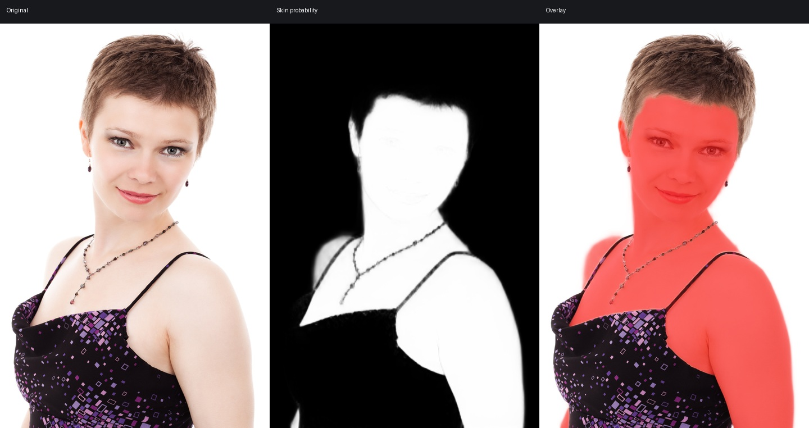
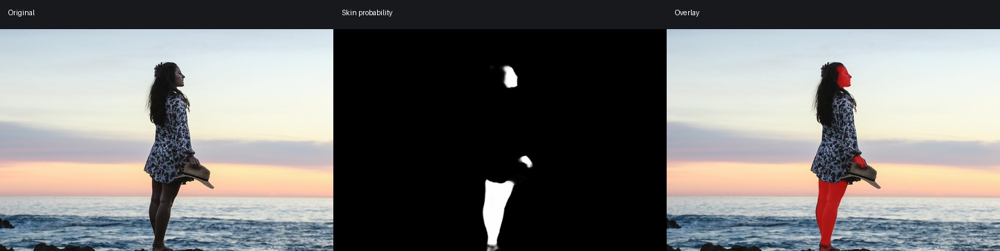
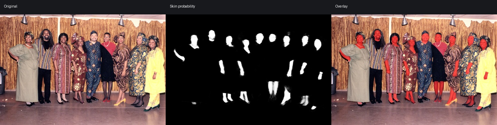
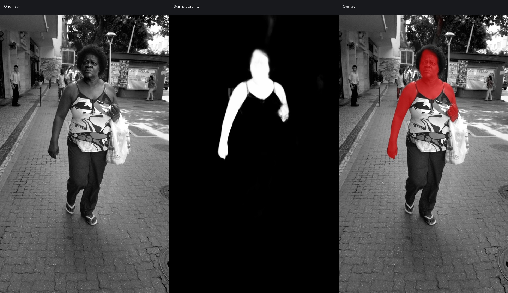

# Stars Speck Character Skin V1 Pro

[](#stars-speck-series)
[](#model-specification)
[](#model-specification)
[](#quick-start)
[](#model-specification)
[](LICENSE.md)

**Stars Speck Character Skin V1 Pro** is a professional visible-human-skin segmentation model for portrait retouching, character editing and human-parsing pipelines. It predicts a continuous probability map for exposed face and body skin, including small and distant people.

> 中文说明见 [README.zh-CN.md](README.zh-CN.md).

## Highlights

- SegFormer-B2 backbone with a binary skin-probability head.
- Dynamic spatial input: square, portrait and landscape tensors are supported.
- Reliable multi-person and small-region recognition across varied portrait scenes.
- Tested on portraits, full-body subjects, groups, varied skin tones, monochrome images and complex clothing.
- Production-friendly ONNX graph with no custom operators.

## Model specification

| Item | Value |
|---|---|
| Public name | Stars Speck Character Skin V1 Pro |
| Series | Stars Speck |
| Task | Visible human skin segmentation |
| Architecture | SegFormer-B2 |
| Parameters | approximately 27.4M |
| Model file | `stars-speck-character-skin-v1-pro-b2-fp32-dynamic.onnx` |
| File size | 109,891,087 bytes / 104.80 MiB |
| Precision | FP32 |
| Input | `image`, float32, `[N, 3, H, W]` |
| Output | `skin_probability`, float32, `[N, 1, H, W]` |
| Recommended sizes | `512×512`, `512×1024`, `1024×512`, `1024×1024` |
| Recommended threshold | `0.5` |
| SHA-256 | `072817eecd40af194d7ea2fc120a649ed4f26f149b6a2f947c0710d0c7cb7b52` |

Input is RGB, scaled to `[0, 1]`, then normalized with ImageNet statistics:

```text
mean = [0.485, 0.456, 0.406]
std  = [0.229, 0.224, 0.225]
```

Preserve aspect ratio by resizing and padding to a multiple of 32. For distant or crowded subjects, detect each person and run the model on expanded person ROIs.

## Validation

| Metric | Result |
|---|---:|
| IoU | **0.858610** |
| Dice / F1 | **0.923927** |
| Precision | **0.918570** |
| Recall | **0.929347** |
| Small-region recall | **0.847340** |
| Composite score | **0.856356** |

Metrics are measured on the prepared held-out validation split. They do not guarantee identical performance for every camera, demographic or editing workflow.

## Quick start

The ONNX file is larger than GitHub's regular 100 MB object limit. This repository includes a Git LFS rule; install Git LFS before cloning, or attach the model file to a GitHub Release.

```bash
git lfs install
git clone <repository-url>
```

```bash
pip install -r requirements.txt
python inference.py input.jpg --output skin_probability.png --overlay skin_overlay.jpg
```

The script preserves aspect ratio, pads to the requested inference size and maps the probability field back to the original image. Use `--long-edge 512` for faster previews or `--long-edge 1024` for quality-oriented inference.

## Examples

The red overlay represents predicted visible skin at continuous probability strength. These are qualitative tests, not annotated benchmarks.

### Clear fashion portrait



Face, neck, shoulders and arms are recovered while clothing and most jewelry remain excluded.

### Outdoor full-body subject



The model retains small face, hand and leg regions in a wide outdoor scene.

### Multi-person event



Multiple faces, arms and legs are detected across varied poses and clothing.

### Dark-skin portrait



The model detects exposed skin under monochrome rendering and outdoor contrast.

See [TEST_REPORT.md](TEST_REPORT.md) and [examples/manifest.json](examples/manifest.json) for limitations, provenance and image licenses.

## Recommended production pipeline

```text
person detector / subject alpha
            ↓
expanded per-person ROI
            ↓
Stars Speck Character Skin V1 Pro
            ↓
exclude hair, clothing, gloves and face-detail protection masks
            ↓
edge-aware resize and subject-alpha constraint
```

The model is a skin semantic component, not a complete portrait parser. Eyes, eyebrows, lips, teeth, facial hair and accessories should be protected with dedicated face-detail masks when local retouching requires them.

## Training-data disclosure

V1 Pro uses a multi-source training corpus containing **15,000+ images**, including public portrait and human-understanding data and **Stars Speck Portrait**, a privately curated collection of **3,000+** portrait and character images. No private training images are distributed with the weights.

## Intended use

- Portrait and body-skin adjustment masks.
- A skin channel in a human-parsing or character-editing stack.
- Research and non-commercial tools allowed by the weight license.

## Limitations

- Facial features are contained within the face-skin region; use additional facial-feature protection masks when required.
- Historical photos, low-contrast images and extremely distant people may lose small hand regions.

## Stars Speck series

Stars Speck is a family of focused visual-understanding models for character, portrait and creative-image workflows. Each model targets one reusable semantic layer and is designed to compose with other masks rather than replace a complete editing pipeline.

## Citation

```bibtex
@misc{stars-speck-character-skin-v1-pro,
  title        = {Stars Speck Character Skin V1 Pro},
  author       = {Stars Speck},
  year         = {2026},
  howpublished = {ONNX model release}
}
```

Please also cite SegFormer when using the architecture:

```bibtex
@article{xie2021segformer,
  title={SegFormer: Simple and Efficient Design for Semantic Segmentation with Transformers},
  author={Xie, Enze and Wang, Wenhai and Yu, Zhiding and Anandkumar, Anima and Alvarez, Jose M. and Luo, Ping},
  journal={NeurIPS},
  year={2021}
}
```
