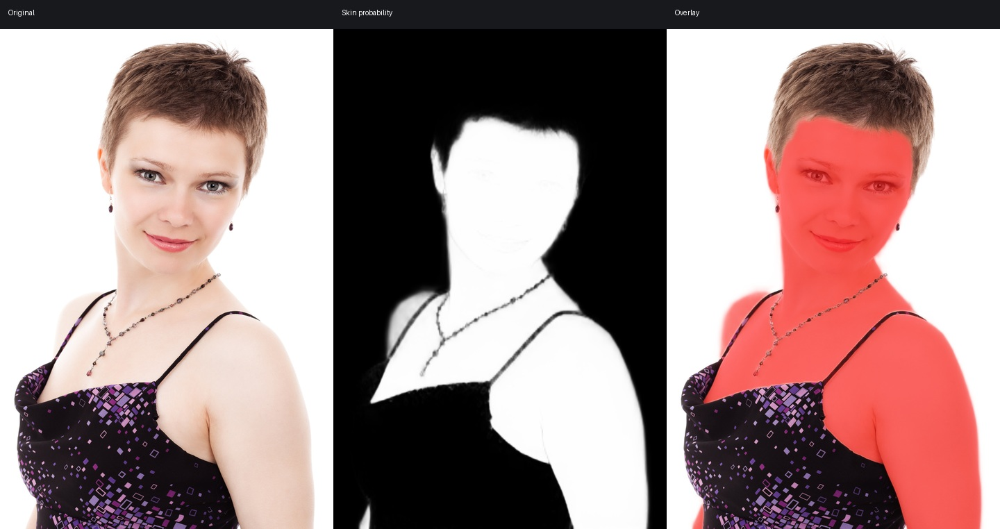
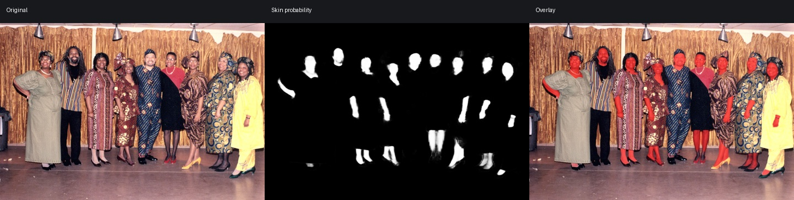
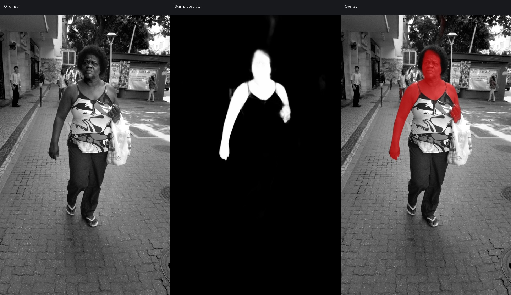

# Stars Speck Character Skin V1 Pro

[English](README.md) · [测试报告](TEST_REPORT.md) · [模型许可](LICENSE.md)

**Stars Speck Character Skin V1 Pro** 是 Stars Speck 系列中的专业可见人体皮肤分割模型，面向人像修图、角色编辑与人体语义解析。模型输出连续皮肤概率图，重点提升多人、小区域、远景人物和复杂服装环境下的稳定性。

## 核心特性

- SegFormer-B2 主干网络，约 2740 万参数。
- ONNX FP32 格式，无自定义算子。
- 支持动态空间尺寸，可输入横图、竖图和正方形图像。
- 支持 `512×512`、`512×1024`、`1024×512` 和 `1024×1024`。
- 对多人、小面积皮肤、遮挡与复杂服装场景保持稳定识别。

## 模型规格

| 项目 | 内容 |
|---|---|
| 公开名称 | Stars Speck Character Skin V1 Pro |
| 系列 | Stars Speck |
| 任务 | 可见人体皮肤分割 |
| 架构 | SegFormer-B2 |
| 模型文件 | `stars-speck-character-skin-v1-pro-b2-fp32-dynamic.onnx` |
| 文件体积 | 104.80 MiB |
| 输入 | `image`，float32，`[N, 3, H, W]` |
| 输出 | `skin_probability`，float32，`[N, 1, H, W]` |
| 推荐阈值 | `0.5` |
| SHA-256 | `072817eecd40af194d7ea2fc120a649ed4f26f149b6a2f947c0710d0c7cb7b52` |

输入采用 RGB 顺序，先缩放至 `[0,1]`，再使用 ImageNet 均值和标准差归一化：

```text
mean = [0.485, 0.456, 0.406]
std  = [0.229, 0.224, 0.225]
```

## 验证指标

| 指标 | 结果 |
|---|---:|
| IoU | **0.858610** |
| Dice / F1 | **0.923927** |
| Precision | **0.918570** |
| Recall | **0.929347** |
| 小区域召回率 | **0.847340** |
| 综合分数 | **0.856356** |

以上指标来自统一处理后的留出验证集，不代表所有相机、肤色、光照和修图流程中的绝对表现。

## 快速使用

ONNX 文件超过 GitHub 普通 Git 对象的 100 MB 限制。仓库已提供 Git LFS 规则，发布时应使用 Git LFS，或将模型作为 GitHub Release 附件上传。

```bash
git lfs install
git clone <repository-url>
```

```bash
pip install -r requirements.txt
python inference.py input.jpg --output skin_probability.png --overlay skin_overlay.jpg
```

脚本会保持原图比例、补边到合法输入尺寸，并把概率图映射回原始分辨率。快速预览可使用 `--long-edge 512`，质量优先建议使用 `--long-edge 1024`。

## 推荐工程流程

```text
人物检测 / 主体 Alpha
        ↓
按人物生成扩展 ROI
        ↓
Stars Speck Character Skin V1 Pro
        ↓
排除头发、服装、手套与五官保护蒙版
        ↓
边缘感知回贴，并限制在主体范围内
```

该模型只负责皮肤语义，不是完整的人像解析系统。进行局部修图时，应使用专用面部解析蒙版保护眼睛、眉毛、嘴唇、牙齿、胡须和饰品。

## 示例

### 清晰棚拍人像



### 户外全身人物


### 多人活动场景



### 深色皮肤与黑白图像



红色区域代表连续皮肤概率。这些图片仅用于定性回归测试，不是带像素真值的精度测试。来源和许可见 [examples/manifest.json](examples/manifest.json)。

## 训练数据说明

V1 Pro 使用来自多个数据源的 **15,000+** 张训练图像，其中包含公开人像与人体理解数据，以及 **Stars Speck Portrait** 私有数据集中的 **3,000+** 张人像与角色图像。私有训练图像不随模型权重发布。

## 已知限制

- 五官位于脸部皮肤内部，需要额外的五官保护蒙版。
- 老照片、低对比图像和极远人物可能丢失小面积手部。

## Stars Speck 系列

Stars Speck 是面向角色、人像与创意图像工作流的专用视觉理解模型系列。系列模型以可组合的单一语义层为设计目标，便于在专业图像处理流程中与主体、头发、服装、五官等模型协同使用。

模型权重采用 [CC BY-NC 4.0](LICENSE.md) 发布。
